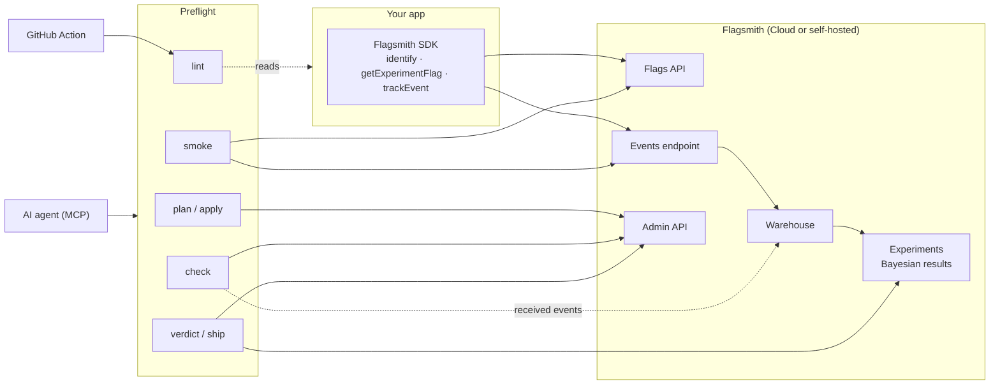

# Preflight

**A Flagsmith experiment can look perfect in the dashboard and still record nothing.
Preflight checks it before launch, proves the data arrives, refuses to call a winner too early, and ships the winner
safely. It works from the command line, from any AI agent over MCP, in CI, and against Flagsmith Cloud or your own
self-hosted Flagsmith.**

Built for *Toggle Wars: The Flagsmith Experimentation Hackathon* (WeMakeDevs × Flagsmith, Nov 26–29 2026).

| | |
|---|---|
| Live page running a real Flagsmith experiment | https://preflight-flagsmith.vercel.app |
| A real AI agent using Preflight over MCP | [docs/agent-transcript.md](docs/agent-transcript.md) |
| Self-hosted Flagsmith + Experimentation in one command | [selfhost/README.md](selfhost/README.md) |
| CI |  |

---

## The problem

Flagsmith Experimentation serves variations through a multivariate flag, collects exposure and conversion events
into a warehouse, and runs a Bayesian engine on them. Several mistakes in that chain raise **no error**. The experiment
runs, the dashboard looks fine, and days later the results still say "collecting data".

We hit four of these ourselves while building this project:

1. The variation we created in the dashboard had **no key**, so it would have recorded no exposures.
2. On self-hosted Flagsmith, both SDKs **sent events to Flagsmith Cloud**, because the events URL defaults to
   Cloud even when flags come from your own server. Flags worked; nothing was recorded.
3. Our fix for (2) in the browser **was silently ignored**. The JavaScript SDK only reads `eventsApiUrl` inside
   `eventProcessorConfig`, not at the top level. A live browser test caught it.
4. After shipping a winner, identified users got it, but **unidentified requests still got the old value**.

Each one is now a Preflight check.

## The four rounds, done safely

The hackathon frames an experiment as four rounds. Preflight covers each one, and every claim below was run against
live Flagsmith.

| Round | Preflight | What it guarantees |
|---|---|---|
| 1. Multivariate flag with the versions | `plan` → `apply` | Read-only plan with the exact API calls; blocks unsafe setups; a human approves; idempotent and resumable |
| 2. Metric from a real event | `plan --code ./app`, `lint`, `check` | The app really sends the metric's event, with the same spelling; the warehouse has actually received it |
| 3. Split traffic | `apply --start`, `smoke` | Every arm is served **and** this run's events provably reached the warehouse |
| 4. Ship the winner | `verdict`, `ship` | Only ships what the evidence supports, then checks what real users are served |

```console
$ preflight ship 2 --environment …          # self-hosted rehearsal, 400 synthetic users in a test environment
Experiment #2 'Checkout CTA' (running)
  Verdict : variant_b wins. Safe to roll it out on the same flag.
            - variant_b: chance to beat control 99.5%, lift 95% CI [+39.5%, +286.7%]
  Decision: roll out variant 'variant_b' to everyone
✓ Shipped. Flagsmith now reports status=completed, decision=variant, variant id 2.
✓ Verified: 20/20 brand-new identified users now get 'treatment'.
! Unidentified requests still get 'control'. If any part of your app evaluates this flag without identifying
  the user, also set the flag's value to 'treatment'.
```

## Commands

| Command | Does | Changes Flagsmith? |
|---|---|---|
| `preflight lint PATH --event E` | Scans JS/TS/Python for the silent failure modes | No |
| `preflight check PATH` | Environment health (warehouse, metrics, experiments, keys, allocations) **plus live data**: which events the warehouse has actually received | No |
| `preflight plan …` | Validates a new experiment and prints the exact API calls, with a fingerprint | No |
| `preflight apply PLAN [--start]` | Re-reads Flagsmith, refuses if anything changed since the plan, asks, applies, audits | Yes, after approval |
| `preflight smoke --flag F --event E` | Synthetic users through the real SDK into a **test** environment; proves bucketing and ingestion | Test events, after approval |
| `preflight verdict ID [--refresh]` | Go / no-go with Flagsmith's own thresholds | No |
| `preflight ship ID` | Completes the experiment with the decision the evidence supports, then verifies what users get | Yes, after approval |
| `preflight selfhost up \| demo \| down` | Self-hosted Flagsmith with Experimentation, bootstrapped through the API | Local instance |

### Checks

| Rule | Source | Catches |
|---|---|---|
| PF001 | code | Experiment SDK calls, but events never enabled |
| PF002 | code | Experiment flag read without an identity |
| PF003 | code | Event names vs. metric events: case mismatch, unknown event, metric never tracked (constants resolved) |
| PF004 | code | Events enabled in a short-lived script that never flushes or closes |
| PF005 | code | `@flagsmith/flagsmith` < 12.4.0, `@flagsmith/nodejs` < 9.1.0, legacy `flagsmith-nodejs`, Python `flagsmith` < 6.3.0 |
| PF006 | code | Self-hosted flags but events still sent to Flagsmith Cloud, including a top-level `eventsApiUrl` the JS SDK ignores |
| PF101 | Flagsmith | No warehouse connection, or a broken one |
| PF102 | Flagsmith | A variation without a key; a flag that isn't multivariate |
| PF103 | Flagsmith | Experiment created but not running |
| PF104 | Flagsmith | A variation with 0% of traffic |
| PF105 | live data | The metric's event never arrived, or arrived under another casing ("the app sends `Signup_Completed`") |
| PF106 | live data | Running 30+ minutes and the environment has never received an exposure |

PF105 and PF106 read the warehouse's received-event names, so they catch problems **in production, without access
to the code**.

`plan` also **blocks** a second active experiment on the same flag (Flagsmith allows one), an event name that
clashes in case with an existing metric, existing keyless variations, splits that leave control nothing, and app
code that never sends the metric's event.

### Verdict gates (Flagsmith's statistics docs)

- No call until every arm has **≥ 50 identities and ≥ 5 conversions**.
- A winner needs **> 95% chance to beat control and** a 95% credible interval clear of zero.
- Every treatment below 5%: control wins.
- A sample-ratio mismatch (p < 0.001, Flagsmith's or ours) overrides everything.

The WeMakeDevs tutorial's example (84% chance to win, interval −14%..+44%) is **inconclusive**, not a winner.
`ship` refuses inconclusive results. A human can override from the CLI only with `--decision` and a written
`--reason`, which is audited. An AI agent cannot override at all.

## Track 2: AI agents and feature flags

Preflight is an MCP server, so Claude Code, Cursor or any MCP client can run experiments end to end, with a human
approving every change.

| Tool | Annotation | Does |
|---|---|---|
| `preflight_lint` | read-only | Scan code for silent failures |
| `preflight_check` | read-only | Environment, live-data and code health |
| `preflight_plan` | read-only | Validate and preview exact changes; returns a fingerprint |
| `preflight_apply` | destructive | Applies only a fingerprinted plan; refuses if Flagsmith changed since |
| `preflight_verdict` | read-only | Honest go / no-go |
| `preflight_ship_preview` | read-only | What the evidence supports shipping, or why not |
| `preflight_ship` | destructive | Ships only what the evidence supports; no override for agents |

**Proof:** in [docs/agent-transcript.md](docs/agent-transcript.md), Claude Code turns a one-line request into a plan
through these tools. It reports all three blockers found against live Flagsmith and the app code (a running
experiment on the flag, an event-name case clash, the code sending a different spelling), with fixes. It changes
nothing. `python scripts/mcp_e2e.py` runs 12 protocol-level checks against live Flagsmith.

| Judges look for | Preflight |
|---|---|
| Flagsmith CLI, API or MCP | Admin API (20 endpoints: 12 for flags and experiments, 8 to bootstrap a self-hosted instance; several found only in Flagsmith's OpenAPI schema) and an MCP server |
| Saves real time | One request replaces the dashboard flow we did by hand for experiment #692 (we counted about 25 clicks and fields across the Features, Metrics and Experiments screens, and it still shipped a keyless variation). More importantly, it catches mistakes that otherwise cost days of empty data |
| A human approves changes | `apply` and `ship` are destructive-annotated; plans are fingerprint-bound; CLI asks; every call is audited |
| Clear output | Plans list exact calls; every finding has a rule id, the consequence and the fix |

Add it to Claude Code: this repo ships a `.mcp.json`, so opening the folder is enough (or
`claude mcp add preflight -- python -m preflight.mcp_server`).

## Track 3: build on open-source Flagsmith

```bash
preflight selfhost up      # Docker: Flagsmith + Postgres, Experimentation on, bootstrapped via the API
preflight selfhost demo    # the demo experiment on your instance, and the demo page pointed at it
```

`up` waits for health, creates the admin, organisation, project, Development and Production environments, connects
the Flagsmith-database warehouse and creates an API key, all idempotently. Secrets are generated randomly into a
git-ignored file. Every Preflight command then works against it with `--env-file selfhost/.env.local`.

Verified on the self-hosted instance: plan → apply → start → smoke → verdict → ship, with exact event counts, and a
real browser click from the demo page arriving in the local warehouse.

| Judges look for | Preflight |
|---|---|
| Self-hosted Flagsmith | One-command kit based on the official compose file, with secrets moved out of it |
| Integrations and plugins | MCP server, GitHub Action, CLI |
| Developer tools | Lint, platform checks, smoke tests with ingestion proof, verdicts, shipping |
| Easy to reuse | `pip install`, one command each; `uses: roybishal362/preflight-flagsmith@main` in CI |

## In CI (GitHub Action)

```yaml
- uses: roybishal362/preflight-flagsmith@main
  with:
    path: web
    events: demo_button_clicked,signup_completed
```

This repo's own CI runs it on the demo page on every push.

## Architecture



Flagsmith features used: multivariate flags with keyed variations, environments, identities, Experimentation
(metrics, experiments, rollout, start, complete with a rollout decision, Bayesian results with lift, credible interval
and chance to win, SRM), the managed and the Flagsmith-database warehouses and their received-event lists, the Admin
API, self-hosting with Docker, and the JavaScript and Python SDKs with events.

## Live evidence (2026-11-26)

| What | Where | Result |
|---|---|---|
| Live page sends exposures and conversions | Cloud #692 | Two builder test clicks appear as `control: n=2, sum=2` |
| `plan` blocks unsafe setups | Cloud | Duplicate experiment + case-clashing event blocked for 3 reasons, nothing sent |
| `apply` is resumable | Cloud #697 | First run stopped at step 2 on an undocumented API rule (variation body needs `feature`); after the fix, re-planning skipped the flag and finished |
| `smoke` exact ingestion | Cloud #697 | 120 identities: Flagsmith counted exactly `63 / 57` and `24 + 13 = 37` conversions |
| `smoke` exact ingestion | Self-hosted #1 | 120 identities: exactly `64 / 56`, `23 + 14` |
| PF006 is real | Self-hosted #1 | Same smoke with the Cloud events URL: flags served, Cloud refused the events (403), local counts unchanged |
| `smoke` ingestion proof | Self-hosted, Cloud | Pass with correct URLs (37 s / 8 s); fails with the PF006 hint when misconfigured |
| `verdict` | Cloud #697 | 1.1% chance to win, CI [−74.7%, −5.6%] → "Control wins" |
| `ship` control | Cloud #697 | `status=completed, decision=control`, read back from Flagsmith |
| Full four rounds | Self-hosted #2 | 99.5%, CI [+39.5%, +286.7%] → shipped `variant_b`; 20/20 new identified users get it |
| `ship` refuses | Self-hosted #1 | 6.4%, CI crosses zero → refused; override without a reason refused |
| Real agent over MCP | Cloud | Claude Code planned safely, found 3 blockers, changed nothing |
| Browser → self-hosted | Self-hosted #3 | `POST localhost:8000/api/v1/events` 202; warehouse lists `$flag_exposure`, `demo_button_clicked` |
| CI | GitHub Actions | Tests and the Preflight Action pass on every push |

Smoke experiments use deterministic synthetic conversions in test environments; their "results" demonstrate the
pipeline, not a real effect.

## What we learned about Flagsmith (worth fixing upstream)

| Finding | Evidence |
|---|---|
| `@flagsmith/flagsmith` 12.6 reads the events URL only from `eventProcessorConfig.eventsApiUrl` (typed `@internal`); a top-level `eventsApiUrl` is ignored | Browser test: events went to `events.api.flagsmith.com`; `src/flagsmith-core.ts` |
| Both SDKs default events to Flagsmith Cloud even when `api` / `api_url` point at a self-hosted server | Self-hosted smoke; Python `EventProcessorConfig` default |
| `POST …/features/{id}/mv-options/` also requires `feature` in the body | HTTP 400 "This field is required" |
| `complete/`, `rollout/`, `pause/`, exposures and warehouse event lists exist but aren't in the Experimentation guides | Flagsmith OpenAPI schema (`/api/v1/swagger.json`) |
| After completing with a variant, unidentified evaluations still return the old value | SDK evaluation after `ship` on self-hosted #2 |
| The warehouse's `total_events_received` lags; it can't attribute events to a run | Two consecutive smoke runs; replaced with a per-run probe event |

## The real experiment (Track 1)

- **Hypothesis:** A clearer CTA label ("Try the live demo now") increases demo button clicks compared with "Get the demo".
- **Flag:** `show_demo_button`. Control `control` ("Get the demo"), variation `variant_b` ("Try the live demo now").
- **Metric:** `Demo button click`, event `demo_button_clicked`, occurrence, higher is better.
- **Split:** 100% of visitors, 50/50. Visitors are identified by a random ID in `localStorage`; no personal data.
- **Data hygiene:** two identities are the builder's own test clicks (both control), disclosed here.
- **Result:** `preflight verdict 692`, reported only once the gates are met.

## Quick start

```bash
python -m venv .venv && .venv/Scripts/activate        # Windows; use bin/activate elsewhere
pip install -e ".[mcp,dev]"

preflight lint path/to/app --event your_metric_event   # no account needed

cp .env.example .env    # FLAGSMITH_ENVIRONMENT_KEY, FLAGSMITH_API_KEY (Organisation API key),
                        # FLAGSMITH_SMOKE_ENVIRONMENT_KEY (a separate test environment)
preflight check path/to/app
preflight plan --name "Checkout copy" --flag checkout_button --variant pay_now="Pay now" \
               --event checkout_completed --hypothesis "Shorter copy increases completed checkouts" --code path/to/app
preflight apply .preflight/plans/<fingerprint>.json --start
preflight smoke --flag checkout_button --event checkout_completed
preflight verdict <experiment id> --refresh
preflight ship <experiment id>
```

## Safety

- **Human in the loop:** `apply`, `smoke` and `ship` ask first and refuse in a non-interactive shell without `--yes`.
- **No stale approvals:** plans are fingerprinted; `apply` rebuilds from live state and stops on any difference.
- **Partial failure is safe:** `apply` stops at the first failed call, reports what exists, and re-planning resumes.
- **No pollution:** `smoke` refuses the live experiment's environment; synthetic identities are prefixed.
- **Evidence gates:** `ship` follows the verdict; overrides need a written reason and are audited; agents can't override.
- **Audit log:** every plan, apply step, smoke run, verdict and ship goes to `.preflight/audit.jsonl`.
- **Secrets:** keys live in git-ignored files and are never printed; self-host secrets are generated randomly.

## Tests

```bash
python -m pytest -q          # 37 unit tests; platform tests use payloads captured from live Flagsmith
python scripts/mcp_e2e.py    # 12 MCP protocol checks against live Flagsmith (read-only)
```

## Limitations

- `lint` uses patterns, not a full parser. It resolves simple constants and ignores strings and comments, but it can
  miss calls built dynamically or wrapped in your own helpers.
- Experimentation is in beta. `check`, `verdict` and `ship` rely on API shapes captured on 2026-11-26; tests pin them.
- `plan` handles string-valued variations and one primary metric.
- The self-hosted kit uses the Flagsmith-database warehouse, which Flagsmith positions for evaluation, not production volume.

## License

MIT
